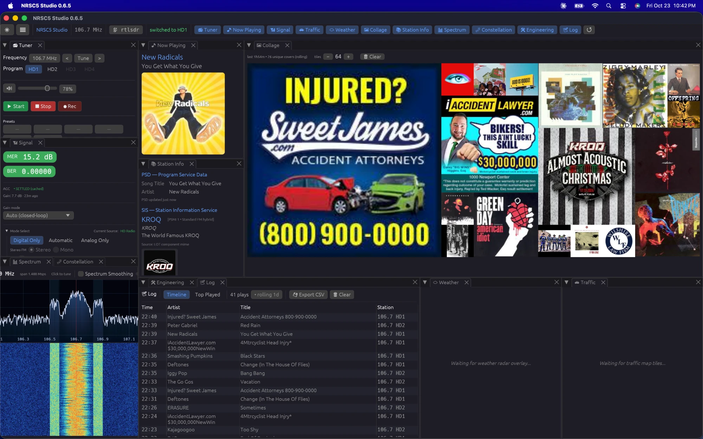

# macOS Bring-Up (macOS Port)

This project is Windows- and Linux-supported, but the Rust crate already
builds unmodified on macOS — the only native work is building
`libnrsc5.dylib` and the SoapySDR device stack. Use this runbook to
validate a native macOS build. Verified end-to-end (live HD1/HD2 decode,
album art, CoreAudio output) on macOS 26 / Intel with an RTL-SDR Blog V3;
the same recipe is expected to carry to Apple Silicon with
`NRSC5_USE_SSE=OFF`.



## 1. Toolchain

```bash
xcode-select --install                      # cc, make, git, install_name_tool
curl --proto '=https' --tlsv1.2 -sSf https://sh.rustup.rs | sh -s -- -y
brew install autoconf automake libtool      # for the bundled autotools sub-builds
pip3 install cmake                          # prebuilt wheel
```

Why rustup and a pip cmake instead of `brew install rust cmake`: on
hosts without Homebrew bottles (notably Intel Macs on macOS 26, the
last Intel release) brew falls back to compiling rustc and its full
dependency chain from source — hours of build for no benefit. rustup
and the cmake wheel are prebuilt upstream binaries.

With CMake >= 4, keep `CMAKE_POLICY_VERSION_MINIMUM=3.5` exported when
configuring the SDR libraries below; some of their CMakeLists predate
3.5 and CMake 4 refuses them otherwise. (`scripts/build-nrsc5-macos.sh`
exports it for you.)

## 2. SDR runtime stack (librtlsdr, SoapySDR, SoapyRTLSDR)

The app talks to hardware through SoapySDR, so you need libSoapySDR,
the SoapyRTLSDR module, and librtlsdr. Homebrew's copies work where
bottles exist; building from source is a few minutes total and is shown
here with a self-contained prefix:

```bash
export SDR_PREFIX="$HOME/.local/sdr-stack"
export CMAKE_POLICY_VERSION_MINIMUM=3.5

# librtlsdr (the rtlsdrblog fork also supports the V4 dongle)
git clone --depth 1 https://github.com/rtlsdrblog/rtl-sdr-blog.git
cmake -S rtl-sdr-blog -B rtl-sdr-blog/build \
  -DCMAKE_BUILD_TYPE=Release -DCMAKE_INSTALL_PREFIX="$SDR_PREFIX" \
  -DDETACH_KERNEL_DRIVER=OFF -DINSTALL_UDEV_RULES=OFF
cmake --build rtl-sdr-blog/build -j && cmake --install rtl-sdr-blog/build

# SoapySDR core
git clone --depth 1 https://github.com/pothosware/SoapySDR.git
cmake -S SoapySDR -B SoapySDR/build \
  -DCMAKE_BUILD_TYPE=Release -DCMAKE_INSTALL_PREFIX="$SDR_PREFIX" \
  -DENABLE_PYTHON=OFF -DENABLE_PYTHON3=OFF
cmake --build SoapySDR/build -j && cmake --install SoapySDR/build

# SoapyRTLSDR module
git clone --depth 1 https://github.com/pothosware/SoapyRTLSDR.git
cmake -S SoapyRTLSDR -B SoapyRTLSDR/build \
  -DCMAKE_BUILD_TYPE=Release -DCMAKE_INSTALL_PREFIX="$SDR_PREFIX" \
  -DCMAKE_PREFIX_PATH="$SDR_PREFIX" \
  -DRTLSDR_INCLUDE_DIR="$SDR_PREFIX/include" \
  -DRTLSDR_LIBRARY="$SDR_PREFIX/lib/librtlsdr.dylib"
cmake --build SoapyRTLSDR/build -j && cmake --install SoapyRTLSDR/build
```

### 2a. Fix the install names (one-time)

CMake installs these dylibs with `@rpath` install names but bakes no
`LC_RPATH` into the Soapy module, so module loading only works with
`DYLD_LIBRARY_PATH` set. For a local install, rewrite the references to
absolute paths once and everything resolves env-free:

```bash
for lib in libSoapySDR.0.9.dylib librtlsdr.0.dylib; do
  install_name_tool -id "$SDR_PREFIX/lib/$lib" "$SDR_PREFIX/lib/$lib"
done
for f in "$SDR_PREFIX"/lib/SoapySDR/modules*/*.so "$SDR_PREFIX"/bin/*; do
  [ -f "$f" ] || continue
  otool -L "$f" | awk '/@rpath\//{print $1}' | while read -r ref; do
    install_name_tool -change "$ref" "$SDR_PREFIX/lib/${ref#@rpath/}" "$f" 2>/dev/null || true
  done
done
```

(Install-name surgery invalidates ad-hoc code signatures; on Intel that
is harmless. On Apple Silicon re-sign afterwards:
`codesign -f -s - <file>`.)

### 2b. Smoke-test the dongle

```bash
"$SDR_PREFIX/bin/rtl_test"             # direct librtlsdr path
"$SDR_PREFIX/bin/SoapySDRUtil" --find  # the path the app actually uses
```

`SoapySDRUtil --find` must list `driver = rtlsdr`. Note that SoapySDR
master installs modules to `lib/SoapySDR/modules0.9/` — if discovery
fails, check that directory exists rather than assuming `modules0.8`.

## 3. Build libnrsc5.dylib

```bash
bash scripts/build-nrsc5-macos.sh
```

This is the macOS port of `scripts/build-nrsc5-linux.sh`: same pinned
nrsc5 tag, same `USE_STATIC=ON` self-contained build, same two source
patches. The macOS-specific part is one link line — the embedded
libusb's darwin backend needs
`-framework IOKit -framework CoreFoundation -framework Security -lobjc`
on the final dylib link — plus `install_name_tool` in place of
`patchelf`. The result is staged at `bin/libnrsc5.dylib` with the header
synced to `res/nrsc5.h`.

## 4. Build and run the app

```bash
export PKG_CONFIG_PATH="$SDR_PREFIX/lib/pkgconfig"
cargo build --release
./target/release/nrsc5-studio
```

No Rust changes are needed; `build.rs` already adds the workspace
`bin/` directory to the link search path, so the staged
`libnrsc5.dylib` is found by `#[link(name = "nrsc5")]` as-is. cpal
drives CoreAudio directly ("[audio] opened 'MacBook Pro Speakers' ..."
on stdout confirms it).

## 5. If SoapySDR device discovery fails inside the app

```bash
"$SDR_PREFIX/bin/SoapySDRUtil" --find
"$SDR_PREFIX/bin/SoapySDRUtil" --probe="driver=rtlsdr"
```

If those work but the app finds nothing, the app is linking a different
libSoapySDR than the one whose modules you installed — check with
`otool -L target/release/nrsc5-studio | grep -i soapy`. If they fail
with an image-not-found error, redo step 2a (or set
`DYLD_LIBRARY_PATH="$SDR_PREFIX/lib"` as a temporary check).

## Known gaps

- No macOS packaging yet: no .app bundle, no signed/notarized build,
  and the staged `bin/libnrsc5.dylib` carries an absolute install name
  (right for dev builds; a distributable .app wants
  `@rpath/libnrsc5.dylib` plus an `@loader_path` rpath).
- SDRplay: untested on macOS. The SDRplay API service probe is
  Windows-only by design (`sdr_detect.rs`), so native-mode SDRplay
  likely needs the vendor's macOS API package plus SoapySDRPlay3 —
  out of scope for this bring-up.
- Apple Silicon: unverified. Expected deltas: `NRSC5_USE_SSE=OFF` for
  the libnrsc5 build and re-signing after install-name surgery (2a).
- Rare segfault at device close (observed once in two days of heavy
  use): SIGSEGV in libusb's darwin backend (`do_close`, null + 0x8)
  via `SoapyRTLSDR::~SoapyRTLSDR` → `rtlsdr_close`, on app quit. The
  app's own teardown ordering is correct (streams deactivate and close
  before the device is unmade — verified against `src/sdr/soapy.rs`),
  so the race lives below the app, in the
  SoapyRTLSDR/librtlsdr/libusb-darwin close sequence; macOS's libusb
  backend punishes librtlsdr's async-cancel teardown race harder than
  Linux's does. Harmless in practice (fires at exit, after state is
  saved) but worth knowing when triaging macOS crash reports — the
  `.ips` will blame libusb, not this codebase. Seen with libusb
  1.0.29.
